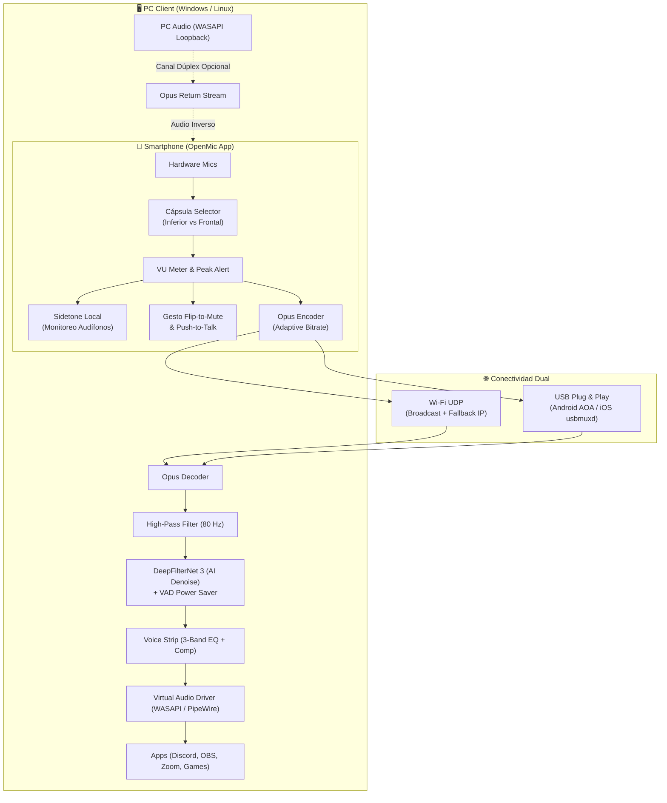
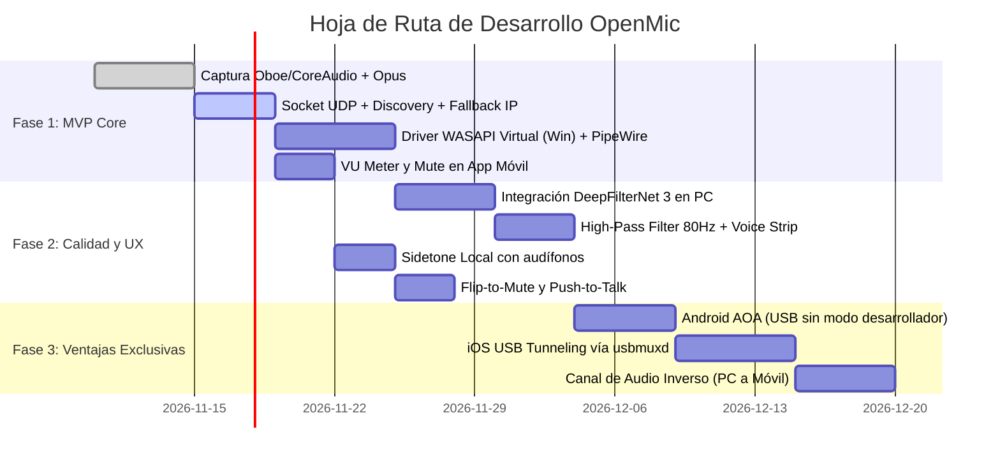

# Propuestas de Mejora y Arquitectura Lean para OpenMic

> **Documento de Diseño Técnico, Oportunidades por Feature y Hoja de Ruta (Roadmap)**  
> **Proyecto:** OpenMic (Alternativa de alto rendimiento a Micstream)  
> **Enfoque de diseño:** *Lean & High-Impact* — Máxima diferenciación y valor para el usuario final sin disparar la complejidad técnica ni inflar el alcance (*scope creep*).

---

## 1. Filosofía de Producto: "Calidad de Estudio con Cero Fricción"

Micstream demostró que existe una demanda masiva (más de 100.000 descargas en Android y excelente tracción en iOS) para usar el smartphone como micrófono de PC con calidad superior a micrófonos USB de gama de entrada. Sin embargo, su análisis técnico revela varias debilidades operativas:
1. **Fricción en redes:** Si el router bloquea UDP Broadcast (*AP Isolation*), la app queda inoperativa sin alternativa de conexión manual.
2. **Fricción en USB:** Requiere depuración ADB en Android (asusta a usuarios no técnicos) y no admite USB en iOS.
3. **Procesamiento rígido:** No ofrece ecualización, control de dinámica ni corte de frecuencias bajas molestas.
4. **Monetización castigadora:** El tiempo de 1 hora por anuncio corre incluso cuando el micrófono está apagado.

**OpenMic** puede capitalizar estas deficiencias mediante un conjunto de mejoras directas, modulares y de bajo esfuerzo de desarrollo.

---

## 2. Desglose Detallado de Propuestas Feature por Feature



---

### Módulo A: Captura Acústica Inteligente en el Smartphone

#### A.1. Selección de Cápsula de Micrófono Física (Mic Selector)
* **Deficiencia en Micstream:** Utiliza la fuente de audio por defecto (`DEFAULT` / `MIC`). La mayoría de usuarios coloca el teléfono de pie sobre la mesa o en un soporte, obstruyendo el orificio inferior del micrófono y provocando un sonido apagado.
* **Propuesta OpenMic:**
  * Permitir alternar explícitamente entre:
    * **Micrófono Inferior:** Modo mano alzada / conferencia horizontal.
    * **Micrófono Frontal / Superior:** Modo atril de escritorio (apuntando hacia la boca del usuario).
* **Viabilidad Lean:** En Android se implementa mediante `MicrophoneInfo` y `AudioRecord.setPreferredDevice()`. En iOS mediante `AVAudioSession.sharedInstance().setPreferredInputOrientation()`. Son menos de 25 líneas de código que mejoran drásticamente la relación señal-ruido antes de cualquier procesamiento digital.

#### A.2. VU Meter en Tiempo Real con Indicador de *Clipping*
* **Deficiencia en Micstream:** La interfaz solo muestra si está conectado o no, sin retroalimentación de amplitud.
* **Propuesta OpenMic:**
  * Barra gráfica de decibelios (dBFS) de respuesta rápida con codificación de colores:
    * **Verde (-40 a -12 dBFS):** Nivel óptimo.
    * **Amarillo (-12 a -3 dBFS):** Picos saludables de voz.
    * **Rojo (> -3 dBFS):** Aviso visual de saturación digital (*clipping*).
* **Viabilidad Lean:** Cálculo aritmético simple del valor pico/RMS en cada buffer de muestras de audio en el hilo de captura antes de pasarlo al encoder Opus.

---

### Módulo B: Cadena de Efectos de Voz (*Voice Strip* Ligera vs VST)

#### B.1. Por qué evitar un Host VST3 Completo
Cargar plugins VST3 externos (FabFilter, iZotope, etc.) introduce:
* Necesidad de un framework pesado de audio (tipo JUCE) que incrementa el instalador en más de 60 MB.
* Manejo de interfaces gráficas flotantes en Windows y Linux (X11/Wayland).
* Riesgo de cuelgues del proceso por bugs en librerías DLL/SO de terceros.

#### B.2. La Alternativa Lean: "Studio Voice Strip" Embebida (3 Controles)
Implementar una cadena DSP fija y ultraligera (<300 líneas en C++ o Rust con filtros biquad):

```
[Audio entrante] 
       │
       ▼
┌─────────────────────────┐
│ 1. High-Pass (80 Hz)    │ ---> Corta ruidos mecánicos y golpes en la mesa
└────────────┬────────────┘
             ▼
┌─────────────────────────┐
│ 2. DeepFilterNet 3      │ ---> Elimina ruidos complejos (teclado, ventiladores)
└────────────┬────────────┘
             ▼
┌─────────────────────────┐
│ 3. Vocal Compressor     │ ---> Unifica susurros y gritos (Leveler automático)
└────────────┬────────────┘
             ▼
┌─────────────────────────┐
│ 4. 3-Band Tone (EQ)     │ ---> Perillas: Graves (Cuerpo), Medios, Aire (Brillo)
└────────────┬────────────┘
             │
             ▼
[Al Driver Virtual de Windows/Linux]
```

* **High-Pass Filter a 80 Hz:** Filtro biquad Butterworth de 2º orden. Elimina el "rumble" de baja frecuencia provocado por el roce del teléfono o vibraciones de la mesa antes de que lleguen a la IA.
* **Compresor / Leveler de 1 Botón:** Ajusta dinámicamente la ganancia con ataque suave (10 ms) y liberación (80 ms) para mantener la voz presente sin que los gritos saturen el stream de Discord u OBS.
* **Ecualizador de 3 Bandas:** Control de Graves cálidos (150 Hz Shelf), Presencia vocal (2.5 kHz Peaking) y Brillo (10 kHz Shelf).

---

### Módulo C: Audio Inverso y Monitoreo (*Sidetone*)

#### C.1. Sidetone Local con Latencia Cero (Monitoreo en Audífonos)
* **Deficiencia en Micstream:** Al hablar con el móvil como micrófono y usar auriculares en la PC, el usuario sufre el "efecto tapón" al no escuchar su propia voz.
* **Propuesta OpenMic:**
  * Si el smartphone tiene conectados unos auriculares (cableados por USB-C/3.5mm o Bluetooth), la app desvía una copia del buffer de captura directamente a la salida de audio del teléfono.
  * **Latencia:** Inmediata (<2 ms en Android con Google Oboe), sin pasar por la red.

#### C.2. Audio Inverso PC $\rightarrow$ Teléfono (Dúplex Ligero)
* **Alcance contenido:** En lugar de crear un router multicanal complejo, se implementa un modo secundario:
  * La PC captura el audio del sistema mediante **WASAPI Loopback** (Windows) o monitor de PipeWire (Linux).
  * Envía un flujo Opus de vuelta al móvil por el mismo socket UDP.
  * **Caso de uso:** Permite al usuario levantarse del escritorio con auriculares conectados al móvil y seguir escuchando una llamada de Zoom o partida de juego.

---

### Módulo D: Optimización de IA y Reducción de Carga en CPU

#### D.1. Voice Activity Detection (VAD) Inteligente
* **Deficiencia en Micstream:** DeepFilterNet 3 procesa continuamente cada fragmento de audio recibido, consumiendo CPU incluso cuando el usuario está en silencio durante horas.
* **Propuesta OpenMic:**
  * Implementar un VAD ligero previo (como WebRTC VAD o Silero VAD lite).
  * Si no hay presencia vocal durante más de 1.5 segundos, se suspende la inferencia de DeepFilterNet y se inyecta silencio digital o ruido de confort. Esto reduce el consumo de CPU del cliente de PC a casi **0%** en reposo.

#### D.2. Atajo de Teclado Global (Global Hotkey en PC)
* Permitir configurar una combinación de teclas (ej. `Ctrl + Alt + M` para Mute, o `Ctrl + Alt + N` para conmutar la IA) registrada en el sistema operativo del PC, evitando tener que desbloquear el teléfono en plena partida.

---

### Módulo E: Resiliencia de Red y Conectividad

#### E.1. Conexión Directa por IP o PIN de 4 Dígitos (Bypass de AP Isolation)
* **Deficiencia en Micstream:** En redes corporativas, universitarias, hoteles o routers con "Aislamiento de clientes Wi-Fi", los paquetes UDP Broadcast se descartan. Micstream no ofrece ninguna alternativa manual, generando abandono de la app.
* **Propuesta OpenMic:**
  * Si el auto-descubrimiento no encuentra la PC en 4 segundos, la app despliega:
    1. Un botón *"Ingresar IP de la PC manualmente"*.
    2. O un código numérico / QR generado por el cliente de escritorio con su IP local.

#### E.2. Bitrate Dinámico Adaptativo en Opus
* El receptor de la PC mide el *jitter* y la pérdida de paquetes. Si detecta congestión en la Wi-Fi (pérdida > 3%), envía un paquete de control de vuelta al móvil para reducir el bitrate de Opus de 96 kbps a 32 kbps de forma transparente, previniendo microcortes audibles.

---

### Módulo F: Conexión USB sin Modo Desarrollador

| Plataforma | Estado en Micstream | Solución Propuesta para OpenMic | Ventaja Competitiva |
| :--- | :--- | :--- | :--- |
| **Android** | Depuración ADB manual (complejo para usuarios comunes). | **Protocolo AOA (Android Open Accessory):** La PC actúa como host USB. El usuario conecta el cable y pulsa "Permitir" en un diálogo nativo estándar. | Plug & Play real sin activar "Opciones de Desarrollador". |
| **iOS** | No disponible (solo Wi-Fi). | **Túnel USB vía `usbmuxd` (PeerTalk):** Conexión socket sobre el cable Lightning / USB-C usando el protocolo estándar de Apple. | **Diferenciador masivo:** Única app del mercado con USB por cable en iPhone. |

---

### Módulo G: Control Físico y UX en el Móvil

#### G.1. "Flip-to-Mute" (Gesto Físico con Acelerómetro)
* Colocar el teléfono boca abajo sobre la mesa activa el *Mute* instantáneamente y emite una suave vibración háptica.
* Volver a levantarlo o ponerlo boca arriba reactiva el audio.

#### G.2. Botón Push-to-Talk (PTT) Gigante
* Modo seleccionable en la interfaz donde la pantalla se convierte en un botón grande táctil.
* Ideal para llamadas de coordinación, juegos o entornos ruidosos: solo transmite mientras se mantiene presionado el dedo en la pantalla.

#### G.3. Modo Pantalla OLED de Ultra Bajo Consumo (*Nightstand Mic*)
* Tras 10 segundos de streaming, la pantalla apaga todos los píxeles (negro absoluto OLED) y muestra únicamente un diminuto indicador de estado (punto verde = En vivo; punto rojo = Muteado). Previene el calentamiento y reduce drásticamente el consumo de batería.

---

### Módulo H: Modelo de Monetización Amigable y Sostenible

#### H.1. "Banco de Horas" y Descuento por Uso Efectivo
* **Corrección de la fricción de Micstream:**
  * El tiempo desbloqueado por ver un anuncio recompensado solo se consume **mientras se está transmitiendo audio activamente**.
  * Posibilidad de ver 2 anuncios seguidos antes de una reunión o sesión de juego para acumular 2 o 3 horas ininterrumpidas.

#### H.2. Monetización de Características Pro (No Bloqueo del Uso Básico)
* El micrófono básico con conexión Wi-Fi/USB y DeepFilterNet se mantiene gratuito y sin cortes abruptos.
* Se ofrece una versión **OpenMic Pro** (compra única o suscripción económica) que desbloquea:
  * La **Voice Strip completa** (Compresor + Ecualizador de 3 bandas).
  * El **Canal de Audio Inverso** (escuchar la PC en el teléfono).
  * Widgets de escritorio y modo Push-to-Talk avanzado.

---

## 3. Hoja de Ruta de Implementación (Roadmap Lean por Fases)



### Resumen de Prioridades y Esfuerzo

| Prioridad | Feature Propuesto | Esfuerzo Estimado | Impacto en Usuario |
| :---: | :--- | :---: | :---: |
| **P1** | **Conexión Fallback Manual (IP / PIN)** | 1-2 días | ⭐⭐⭐⭐⭐ (Resuelve el 90% de fallos de conexión) |
| **P1** | **High-Pass Filter (80 Hz) + Mini EQ** | 2-3 días | ⭐⭐⭐⭐⭐ (Voz limpia sin ruidos de mesa) |
| **P1** | **Sidetone Local (Monitoreo con audífonos)** | 1 día | ⭐⭐⭐⭐ (Escuchar tu propia voz sin lag) |
| **P1** | **VU Meter con alerta de clipping** | 1 día | ⭐⭐⭐⭐ (Control visual indispensable) |
| **P2** | **Flip-to-Mute y Push-to-Talk táctil** | 2 días | ⭐⭐⭐⭐ (Diferenciador clave de UX) |
| **P2** | **Voice Strip Compressor / Leveler** | 2-3 días | ⭐⭐⭐⭐⭐ (Evita gritos y nivela susurros) |
| **P2** | **VAD para reposo de DeepFilterNet** | 2 días | ⭐⭐⭐⭐ (Ahorro de CPU en la PC) |
| **P3** | **Android USB vía protocolo AOA** | 4-5 días | ⭐⭐⭐⭐⭐ (Plug & Play real por cable) |
| **P3** | **iOS USB vía `usbmuxd` (PeerTalk)** | 5-6 días | ⭐⭐⭐⭐⭐ (Exclusividad total en el mercado) |
| **P3** | **Audio Inverso (PC $\rightarrow$ Móvil)** | 4-5 días | ⭐⭐⭐⭐ (Audífono inalámbrico de emergencia) |
