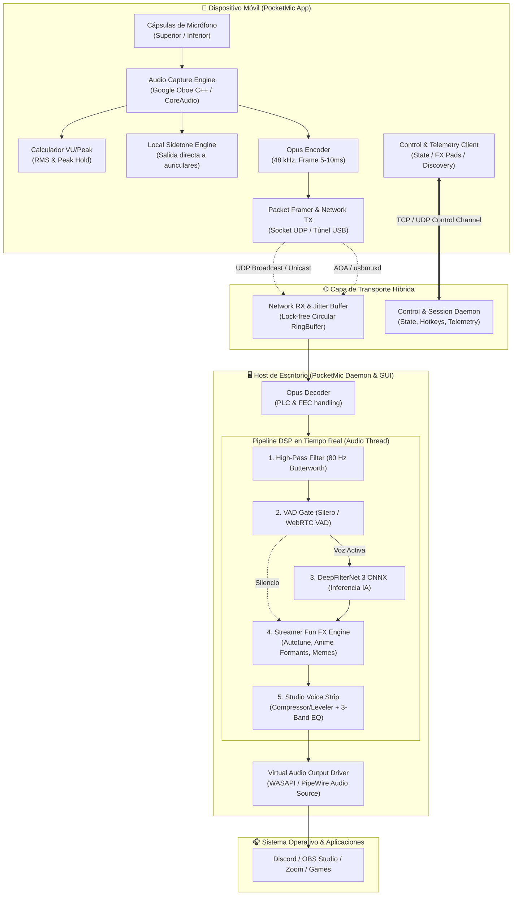
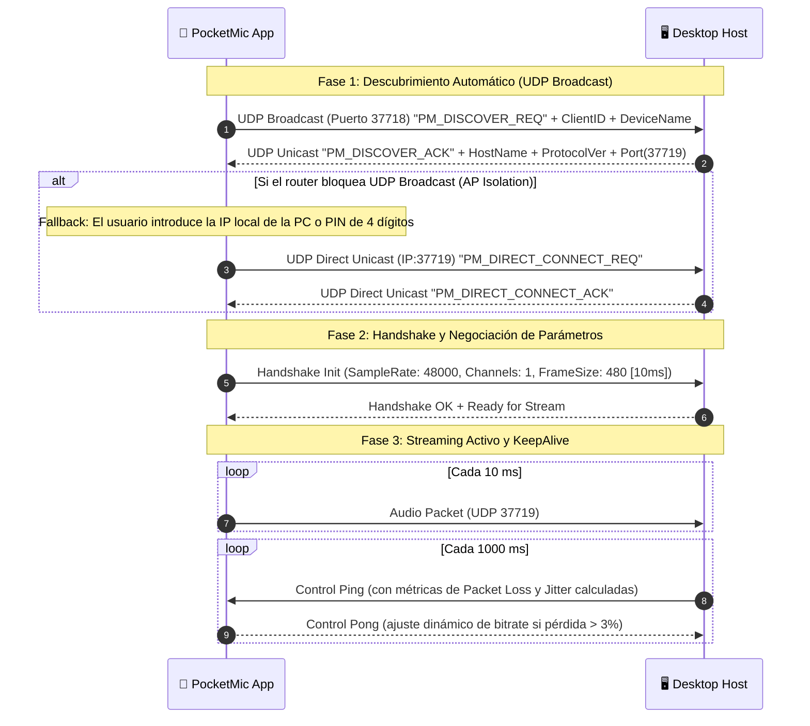
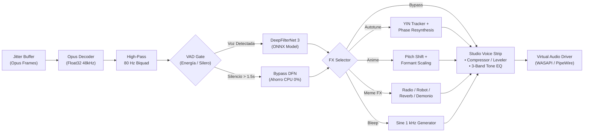
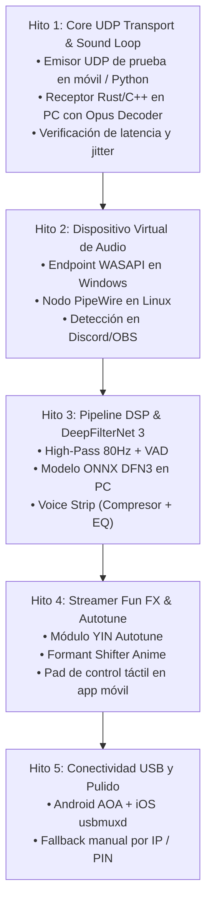

# Software Design Document (SDD) - PocketMic

> **Versión:** 1.0.0  
> **Estado:** Propuesto / En Revisión  
> **Fecha:** Noviembre 2026  
> **Proyecto:** PocketMic  
> **Autores:** Equipo de Ingeniería de PocketMic  

---

## 1. Introducción y Objetivos del Sistema

### 1.1. Propósito
El presente documento de diseño de software (**SDD**) especifica la arquitectura de ingeniería, los contratos de interfaz, las especificaciones de protocolos binarios, los modelos de datos y los pipelines de procesamiento digital de señales (DSP) para **PocketMic**.

El objetivo central es transformar un smartphone convencional (Android / iOS) en un dispositivo físico de captura de audio de estudio para PC (Windows / Linux), ofreciendo latencia ultra-baja, cancelación de ruido por IA en tiempo real y transformación de voz para streamers.

### 1.2. Requerimientos No Funcionales (NFR) y Presupuestos de Rendimiento

| Métrica | Presupuesto Objetivo | Límite Crítico Aceptable | Justificación |
| :--- | :--- | :--- | :--- |
| **Latencia Total End-to-End (Wi-Fi)** | $\le$ 12 ms | $\le$ 20 ms | Vital para juegos y monitoreo de voz en llamadas. |
| **Latencia Total End-to-End (USB)** | $\le$ 5 ms | $\le$ 8 ms | Equivalente a micrófonos USB de escritorio dedicados. |
| **Consumo de CPU en PC** | $\le$ 2.0% (4 cores) | $\le$ 3.5% | No debe degradar FPS en juegos ni rendimiento de OBS. |
| **Consumo de CPU en Móvil** | $\le$ 4.0% | $\le$ 7.0% | Previene recalentamiento y preserva batería. |
| **Formato de Audio Interno** | 48 kHz / 32-bit Float | 48 kHz / 16-bit Int | Margen dinámico infinito sin clipping interno. |
| **Tasa de Muestreo de Red** | Opus @ 64–96 kbps | Opus @ 32 kbps (fallback) | Transmisión transparente a través de Wi-Fi congestionada. |
| **Memoria RAM (PC Daemon)** | $\le$ 45 MB | $\le$ 80 MB | Sin frameworks pesados innecesarios. |

---

## 2. Arquitectura Global del Sistema (C4 Containers)



---

## 3. Especificación del Protocolo de Red y Wire Format

La comunicación entre el móvil y la PC utiliza dos canales independientes:
1. **Canal de Audio (Data Plane):** UDP puro con empaquetado binario estricto para latencia mínima.
2. **Canal de Control y Descubrimiento (Control Plane):** Mensajes binarios compactos para sincronización de estado, handshake y telemetría de red.

### 3.1. Paquete de Audio UDP (Datagram Layout)

Cada datagrama de audio tiene un tamaño de cabecera fijo de **16 bytes**, seguido del payload comprimido en Opus:

```
 0                   1                   2                   3
 0 1 2 3 4 5 6 7 8 9 0 1 2 3 4 5 6 7 8 9 0 1 2 3 4 5 6 7 8 9 0 1
+-+-+-+-+-+-+-+-+-+-+-+-+-+-+-+-+-+-+-+-+-+-+-+-+-+-+-+-+-+-+-+-+
|       Magic ID (0x504D)       |  Version (0x01)| Packet Type  |
+-+-+-+-+-+-+-+-+-+-+-+-+-+-+-+-+-+-+-+-+-+-+-+-+-+-+-+-+-+-+-+-+
|                      Sequence Number (u32)                    |
+-+-+-+-+-+-+-+-+-+-+-+-+-+-+-+-+-+-+-+-+-+-+-+-+-+-+-+-+-+-+-+-+
|                      Timestamp Us (u32)                       |
+-+-+-+-+-+-+-+-+-+-+-+-+-+-+-+-+-+-+-+-+-+-+-+-+-+-+-+-+-+-+-+-+
|  Flags (u8)   | Channels (u8) |       Payload Length (u16)    |
+-+-+-+-+-+-+-+-+-+-+-+-+-+-+-+-+-+-+-+-+-+-+-+-+-+-+-+-+-+-+-+-+
|                   Opus Encoded Audio Data                     |
|                              ...                              |
+-+-+-+-+-+-+-+-+-+-+-+-+-+-+-+-+-+-+-+-+-+-+-+-+-+-+-+-+-+-+-+-+
```

#### Campos de la Cabecera:
* `Magic ID` (16 bits): `0x504D` (Código ASCII `'P' 'M'` para *PocketMic*).
* `Version` (8 bits): `0x01` (Versión del protocolo).
* `Packet Type` (8 bits):
  * `0x01`: Audio Stream Data.
  * `0x02`: Ping / KeepAlive.
  * `0x03`: Pong / Telemetry Response.
* `Sequence Number` (32 bits): Entero monótonamente incremental para detección de pérdida de paquetes y reordenamiento.
* `Timestamp Us` (32 bits): Microsegundos de captura relativos para el cálculo de *jitter*.
* `Flags` (8 bits):
  * `Bit 0`: Mute activo en el cliente (el payload es silencio o confort).
  * `Bit 1`: FEC (*Forward Error Correction*) habilitado en el paquete Opus.
  * `Bit 2`: Clipping detectado en el ADC del smartphone.
  * `Bit 3-7`: Reservado para expansión futura.
* `Channels` (8 bits): `1` (Mono) o `2` (Estéreo).
* `Payload Length` (16 bits): Tamaño exacto en bytes del frame Opus (típicamente entre 40 y 160 bytes por frame de 10 ms).

### 3.2. Protocolo de Descubrimiento y Emparejamiento (Discovery & Handshake)



### 3.3. Paquete de Control de Efectos (FX Control Message)

Cuando el usuario pulsa un botón en la cuadrícula de la app móvil (ej. cambiar a voz Anime o activar Bleep), la app envía un paquete de control inmediato:

```
[Magic: 0x504D] [Type: 0x10 (FX_CMD)] [FX_ID: u8] [Mode: u8] [Param1: u16] [Param2: u16]
```
* `FX_ID`:
  * `0x00`: Normal / Bypass.
  * `0x01`: Autotune (`Param1`: Escala musical [Cromática, Mayor, Menor], `Param2`: Retune speed [0 ms]).
  * `0x02`: Anime / VTuber (`Param1`: Pitch semitonos [+5], `Param2`: Formant ratio [1.22x]).
  * `0x03`: Chipmunk / Ardilla (`Param1`: Semitonos [+8]).
  * `0x04`: Monster / Demonio (`Param1`: Semitonos [-8]).
  * `0x05`: Tactical Radio (`Param1`: Roger Beep On/Off).
  * `0x06`: Robot (`Param1`: Modulator freq [75 Hz]).
  * `0x07`: Megaphone.
  * `0x08`: Cathedral Reverb (`Param1`: Room size, `Param2`: Decay time).
  * `0x09`: Censor Beep (`Mode`: `0x01` activo, `0x00` inactivo).
* `Mode`: `0x00` = Toggle Off, `0x01` = Toggle On, `0x02` = Momentary (Push-to-Effect).

---

## 4. Pipeline de Audio y Especificación DSP (Desktop Engine)

El procesamiento de audio en la PC debe operar en un **hilo de audio prioritario de tiempo real** (*Real-Time Audio Thread*) con las siguientes restricciones estrictas:
* Cero asignaciones dinámicas de memoria (`malloc`, `free`, `new`) dentro del callback de audio.
* Comunicación con hilos de UI/red mediante colas circulares lock-free (*Single-Producer Single-Consumer RingBuffers*).



### 4.1. Algoritmos DSP Detallados

#### 1. Filtro High-Pass (80 Hz)
* **Topología:** Filtro IIR Biquad Butterworth de 2º orden.
* **Propósito:** Cortar ruidos por debajo de 80 Hz generados por vibraciones mecánicas de la mesa, manejo táctil del móvil o corrientes de aire antes de que ingresen a la red neuronal de cancelación.

#### 2. VAD & DeepFilterNet 3 ONNX Engine
* **VAD (Voice Activity Detection):** Evalúa la energía y presencia espectral vocal en bloques de 10 ms.
* **Mecanismo de ahorro:** Si no hay actividad vocal durante más de 1.500 ms, el modelo DeepFilterNet entra en estado dormido (`Idle`), reduciendo el consumo de inferencia a 0% de CPU hasta que se detecta un nuevo fonema.
* **Latencia del modelo:** DeepFilterNet 3 opera con ventanas de 10 ms (480 muestras) y 1 frame de lookahead, agregando únicamente 10 ms de latencia algorítmica.

#### 3. Motor de Autotune en Tiempo Real
* **Paso 1 (Pitch Detection):** Algoritmo YIN modificado o correlación cruzada normalizada rápida (SNAC) para estimar la frecuencia fundamental $f_0$ con precisión sub-hercio en menos de 1.5 ms.
* **Paso 2 (Scale Quantization):** Mapeo de la frecuencia detectada a la nota MIDI más cercana dentro de la escala activa (ej. Pentatónica Menor, Mayor, o Cromática completa).
* **Paso 3 (Phase Vocoder / WSOLA):** Transposición tonal instantánea hacia la frecuencia objetivo.

#### 4. Motor Anime / "Monita China" (Voz Femenina Juvenil / VTuber)
* Para evitar el efecto ardilla (*chipmunk*), el motor separa la altura tonal de la envolvente espectral:
  * **Pitch Shifting:** Sube la fundamental $+4$ a $+6$ semitonos.
  * **Formant Scaling (1.18x – 1.25x):** Aplica un remultiplexado espectral de los polos del tracto vocal mediante filtro cepstral o interpolación de envolvente FFT. Simula un tracto vocal físicamente más corto sin alterar la tasa temporal del habla.

#### 5. Bleep de Censura
* Al activarse `PM_FX_BLEEP`, un multiplexor con desvanecimiento cruzado (*crossfade*) de 2 ms sustituye el flujo del micrófono por un oscilador senoidal puro a 1.000 Hz, eliminando cualquier clic audible al entrar o salir del modo de censura.

#### 6. Studio Voice Strip (Leveler + EQ)
* **Compresor / Leveler:**
  * Detector RMS con ventana de 20 ms.
  * Relación de compresión (*Ratio*): 3:1.
  * Ataque (*Attack*): 10 ms; Liberación (*Release*): 80 ms; Codo suave (*Soft Knee*): 4 dB.
  * Ganancia de compensación automática (*Auto-Makeup Gain*).
* **Ecualizador de 3 Bandas:**
  * Low Shelf: 150 Hz ($\pm 6$ dB) para calidez o control de proximidad.
  * Peaking / Bell: 2.500 Hz ($Q = 1.2$, $\pm 5$ dB) para claridad y presencia de consonantes.
  * High Shelf: 10.000 Hz ($\pm 6$ dB) para aire y brillo de estudio.

---

## 5. Integración con el Sistema Operativo (Virtual Audio Driver)

Para que Windows y Linux detecten a PocketMic como un micrófono de hardware real, se implementa una arquitectura desacoplada:

```mermaid
flowchart TD
    subgraph Windows ["Ventorno Windows"]
        W_DAEMON["PocketMic PC Host (Rust/C++)"]
        W_DEVICE["Dispositivo Virtual de Audio"]
        W_APPS["Discord / OBS / Zoom / Juegos"]
        
        W_DAEMON -->|Opción A: Driver de Kernel Virtual (Virtual Audio Device)| W_DEVICE
        W_DAEMON -->|Opción B: Bridge WASAPI Loopback / VB-Cable Virtual| W_DEVICE
        W_DEVICE -->|WASAPI Capture Endpoint| W_APPS
    end

    subgraph Linux ["Entorno Linux"]
        L_DAEMON["PocketMic Linux Host"]
        L_PIPEWIRE["PipeWire Multimedia Server"]
        L_APPS["Discord / OBS / Steam"]
        
        L_DAEMON -->|libpipewire SPA Virtual Node| L_PIPEWIRE
        L_PIPEWIRE -->|Default Audio Source| L_APPS
    end
```

### 5.1. Estrategia en Windows
* **Fase MVP (Cero Instalación de Drivers):**
  * Integración con endpoints virtuales estándar existentes (VB-Audio Cable API o Virtual Audio Cable) mediante streaming directo por WASAPI Exclusive/Shared Renderer.
* **Fase Final (Driver Nativo PocketMic):**
  * Instalación de un controlador de audio virtual firmado de software (usando el modelo *Microsoft Virtual Audio Device Driver* o enlace con *VAC Driver Kit*) que expone directamente el nombre `"PocketMic Virtual Studio Audio Device"` en el panel de control de sonido (`mmsys.cpl`).

### 5.2. Estrategia en Linux
* Integración nativa con **PipeWire** mediante su API de C/Rust (`pw_filter` o `pw_stream`).
* Creación de un nodo de captura virtual (`media.class = "Audio/Source"`, `node.name = "PocketMic"`).
* No requiere privilegios de superusuario ni módulos de kernel (`systemd --user`).

---

## 6. Arquitectura del Cliente Móvil (Android & iOS)

### 6.1. Android Core
* **Motor de Captura:** Implementado en C++ usando la librería **Google Oboe**.
* **API de Sistema:** Prioridad a `AAudio` (Android 8.0+) con fallback automático a `OpenSL ES`.
* **Modo de Audio:** `OboeAudioStream` configurado con `Usage::VoiceCommunication` o `Usage::Media` con `PerformanceMode::LowLatency` y `SharingMode::Exclusive`.
* **Selección de Cápsula:**
  * Uso de `AudioManager.getMicrophones()` y `AudioRecord.setPreferredDevice()`.
  * Identificación de puertos físicos: `TYPE_BUILTIN_MIC` con orientación frontal (`MIC_DIRECTION_TOWARDS_USER`) para modo atril, o inferior para modo normal.
* **Conexión USB AOA (Android Open Accessory):**
  * No requiere depuración USB ni opciones de desarrollador activadas.
  * El PC actúa como USB Host; Android levanta el accesorio estándar solicitando autorización en un solo toque.

### 6.2. iOS Core
* **Motor de Captura:** `AVAudioSession` configurado con categoría `.playAndRecord` y modo `.measurement` o `.voiceChat` para deshabilitar el procesamiento de eco agresivo del sistema cuando se desee fidelidad plana.
* **Audio Unit:** `kAudioUnitSubType_RemoteIO` operando con buffer de hardware a $0.005$ s (5 ms).
* **Conexión USB Túnel:** Implementación sobre protocolo `usbmuxd` (PeerTalk sobre cable Lightning / USB-C a puerto local TCP de escritorio).

### 6.3. Sidetone Local en Móvil (Zero-Latency Loop)
* Si se detecta un conector de auriculares (`AudioDeviceInfo.TYPE_WIRED_HEADPHONES`, `TYPE_WIRED_HEADSET`, o `TYPE_USB_HEADSET`):
  * El callback de captura de Oboe / AudioUnit copia el buffer recién adquirido directamente al buffer de salida de auriculares.
  * **Latencia medible:** $< 2$ ms (completamente transparente para el habla natural humana sin desfase temporal).

---

## 7. Registro de Decisiones de Arquitectura (ADRs)

### ADR-001: Lenguaje de Implementación del Host de Escritorio
* **Decisión:** **Rust** (con C FFI si se interactúa con APIs de drivers de Windows).
* **Justificación:**
  1. Concurrencia segura y libre de condiciones de carrera para hilos de audio en tiempo real y sockets de red.
  2. Excelente soporte para ONNX Runtime (crate `ort`) y DeepFilterNet (escrito originalmente en Rust).
  3. Cero recolección de basura (*No GC Pauses*), lo que evita saltos y clicks en el stream de audio.
  4. Binarios nativos ligeros y autocontenidos sin dependencias externas en Windows y Linux.

### ADR-002: Framework de la Aplicación Móvil
* **Decisión:** **Kotlin (Android) / Swift (iOS) con núcleo de captura y codificación compartido en C++ (Oboe + libopus)**.
* **Justificación:** Frameworks híbridos como React Native o Flutter introducen *bridges* asíncronos y fluctuaciones de latencia inaceptables en el hilo de captura de audio de alta prioridad. El núcleo de audio debe ser C++ nativo.

### ADR-003: Protocolo de Transporte de Audio
* **Decisión:** **UDP puro con encabezado propietario de 16 bytes y códec Opus**.
* **Justificación:** TCP introduce retrasos catastróficos por retransmisión (Head-of-Line Blocking). WebRTC introduce una sobrecarga masiva de señalización (ICE, STUN, SDP, DTLS). Un protocolo UDP liviano garantiza latencia mínima con control explícito de jitter y corrección de pérdidas por PLC de Opus.

---

## 8. Plan de Implementación y Fases de Verificación



### Criterios de Aceptación para Hito 1 (MVP de Transporte)
1. El receptor de escritorio en PC es capaz de recibir ráfagas continuas de paquetes UDP a 48 kHz.
2. Pérdida de paquetes inferior al 0.5% en red Wi-Fi 5 GHz estándar.
3. Decodificación Opus a 32-bit float sin bloqueos de memoria ni picos de latencia superiores a 15 ms.
4. Recuperación automática si el transmisor se desconecta y reconecta abruptamente.
