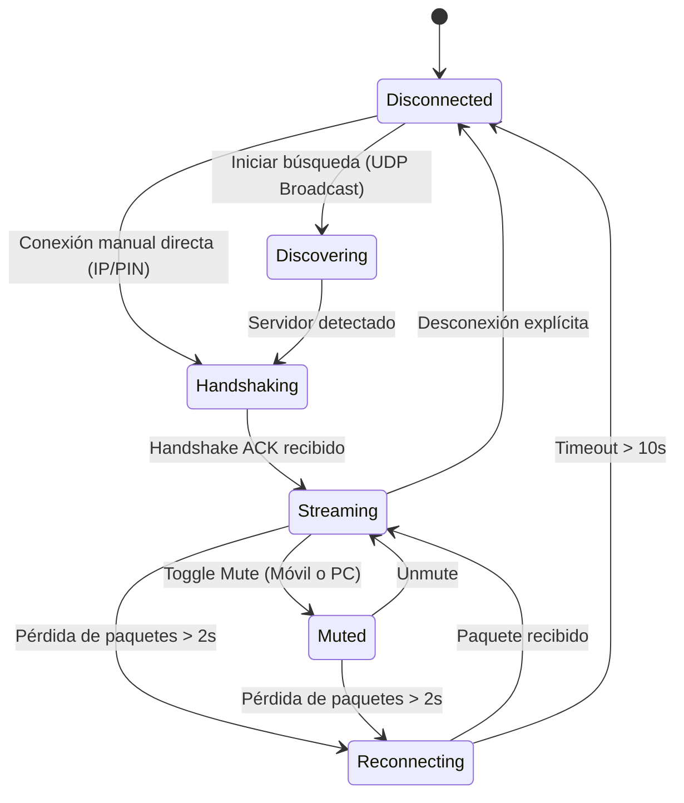

# Data Model: Core Audio Streaming

**Feature**: `001-core-audio-streaming`  
**Date**: 2026-11-09  
**Status**: Completed  

---

## 1. Entidades del Núcleo

### 1.1. `AudioPacketHeader` (Estructura Binaria de Red)
Representa la cabecera fija de 16 bytes que acompaña a cada datagrama UDP de audio.

```rust
#[repr(C, packed)]
pub struct AudioPacketHeader {
    pub magic: u16,          // 0x504D ("PM")
    pub version: u8,         // 0x01
    pub packet_type: u8,     // 0x01: Audio, 0x02: Ping, 0x03: Pong
    pub sequence_number: u32,// Monotónicamente incremental
    pub timestamp_us: u32,   // Microsegundos de captura en el móvil
    pub flags: u8,           // Bit 0: Mute, Bit 1: FEC, Bit 2: Clipping
    pub channels: u8,        // 1 = Mono, 2 = Estéreo
    pub payload_len: u16,    // Tamaño en bytes del frame Opus
}
```

* **Validaciones:**
  * `magic` DEBE ser exactamente `0x504D`. Si no coincide, el paquete se descarta de inmediato.
  * `version` DEBE ser `0x01`.
  * `payload_len` no debe exceder 1.400 bytes (para mantenerse dentro de la MTU estándar de Ethernet sin fragmentación IP).

---

### 1.2. `AudioFrame` (Buffer PCM de Audio)
Representa el bloque de audio en memoria una vez decodificado por Opus:

```rust
pub struct AudioFrame {
    pub sample_rate: u32,      // Fijo a 48_000 Hz
    pub channels: u16,          // 1 (Mono) o 2 (Estéreo)
    pub samples: Vec<f32>,      // 480 muestras por canal para un bloque de 10 ms
    pub is_muted: bool,
    pub clipping_detected: bool,
}
```

---

### 1.3. `SessionState` (Máquina de Estados de Conexión)



* **Estados:**
  * `Disconnected`: En reposo, sockets cerrados.
  * `Discovering`: Emitiendo beacons UDP broadcast (puerto 37718).
  * `Handshaking`: Negociando parámetros de sesión (SampleRate, canales, tamaño de frame).
  * `Streaming`: Transmitiendo y decodificando audio activamente.
  * `Muted`: Transmisión activa pero con payload en silencio / confort noise.
  * `Reconnecting`: Enlace degradado, esperando recuperación sin reiniciar buffer.

---

### 1.4. `NetworkTelemetry` (Métricas de Calidad de Enlace)
Métricas calculadas dinámicamente para telemetría y ajuste de bitrate:

```rust
pub struct NetworkTelemetry {
    pub packets_received: u64,
    pub packets_lost: u64,
    pub packet_loss_rate: f32, // Porcentaje de 0.0 a 100.0%
    pub jitter_ms: f32,         // Estimación RFC 3550
    pub rtt_ms: f32,            // Round-trip time calculado vía Ping/Pong
    pub current_bitrate_kbps: u32,
}
```
