# Tasks: Core Audio Streaming

**Input**: Design documents from `/specs/001-core-audio-streaming/`  
**Prerequisites**: `plan.md`, `spec.md`, `research.md`, `data-model.md`, `contracts/wire-protocol.md`, `quickstart.md`, `.specify/memory/constitution.md`  
**Tests**: TDD approach strictly enforced as mandated by Constitution Principle III. Tests must be written and pass verification for all protocol, buffer, and DSP logic.  

---

## Phase 1: Setup (Shared Infrastructure)

**Purpose**: Inicialización del proyecto de escritorio en Rust y del arnés de pruebas.

- [X] T001 Crear estructura del proyecto `desktop/` y configurar `desktop/Cargo.toml` con dependencias (`cpal`, `audiopus_sys` / `opus`, `ringbuf`, `socket2`, `serde`, `serde_json`).
- [X] T002 [P] Configurar el arnés de pruebas y simulación sintética de audio en `tests/harness/requirements.txt`.
- [X] T003 [P] Actualizar `.gitignore` para excluir artefactos de compilación de Rust (`desktop/target/`) y entornos de prueba.

---

## Phase 2: Foundational (Blocking Prerequisites)

**Purpose**: Estructuras binarias base y buffers lock-free que bloquean la implementación de las historias de usuario.

**⚠️ CRITICAL**: El trabajo en las historias de usuario no puede comenzar hasta completar esta fase.

- [X] T004 Implementar `AudioPacketHeader` (16 bytes con `magic: 0x504D`, versión, sequence number `u32`, timestamp `u32`, flags, canales y longitud) y sus métodos de codificación/decodificación binaria en `desktop/src/net/protocol.rs`.
- [X] T005 [P] Escribir pruebas unitarias de serialización/deserialización, validación de magic bytes y manejo de paquetes truncados en `desktop/tests/unit/protocol_tests.rs`.
- [X] T006 [P] Implementar la abstracción de cola circular lock-free SPSC (`JitterBuffer`) basada en `ringbuf` (garantizando cero allocations y cero mutex en el camino de lectura) en `desktop/src/audio/jitter_buffer.rs`.
- [X] T007 [P] Escribir pruebas unitarias para `JitterBuffer` verificando capacidad fija, comportamiento lock-free y recuperación ante underruns en `desktop/tests/unit/jitter_buffer_tests.rs`.

**Checkpoint**: Infraestructura base validada. La implementación de las historias de usuario puede comenzar.

---

## Phase 3: User Story 1 - Transmisión de voz inalámbrica en tiempo real (Priority: P1) 🎯 MVP

**Goal**: Permitir la transmisión continua de voz desde un emisor UDP hacia el host de PC, decodificando Opus a 48 kHz / 32-bit Float y reproduciendo el audio en WASAPI / PipeWire con latencia imperceptible ($\le 12$ ms).

**Independent Test**: Ejecutar el daemon de PC y el emisor sintético en bucle local (`127.0.0.1:37719`); el audio se debe escuchar de forma continua a 48 kHz sin clicks, cortes ni desbordamientos de buffer.

### Tests for User Story 1 ⚠️

- [X] T008 [P] [US1] Escribir pruebas unitarias del decodificador Opus verificando descompresión de frames de 10 ms (480 muestras) y mitigación de pérdida por PLC en `desktop/tests/unit/decoder_tests.rs`.
- [X] T009 [P] [US1] Escribir prueba de integración para el pipeline de decodificación y traspaso al ring buffer en `desktop/tests/unit/pipeline_tests.rs`.

### Implementation for User Story 1

- [X] T010 [P] [US1] Implementar el decodificador Opus (`OpusDecoderWrapper`) configurado en modo baja latencia (`f32` @ 48 kHz, mono/estéreo) en `desktop/src/audio/decoder.rs`.
- [X] T011 [US1] Implementar el motor de salida de audio `AudioOutputEngine` con `cpal` para WASAPI/PipeWire con callback determinista lock-free en `desktop/src/audio/engine.rs`.
- [X] T012 [US1] Implementar el receptor UDP de alta prioridad (`UdpReceiver`) con socket non-blocking configurado con `SO_RCVBUF` que alimenta el `JitterBuffer` en `desktop/src/net/udp_receiver.rs`.
- [X] T013 [US1] Implementar el punto de entrada CLI y orquestador del daemon en `desktop/src/main.rs`.
- [X] T014 [US1] Implementar el generador de audio sintético y emisor de paquetes UDP en `tests/harness/mock_streamer.py`.
- [X] T015 [US1] Ejecutar validación del Escenario 1 de `quickstart.md` verificando transmisión de tono senoidal a 440 Hz con latencia medida $< 12$ ms.

**Checkpoint**: User Story 1 (MVP) completada y testable de forma 100% independiente.

---

## Phase 4: User Story 2 - Descubrimiento automático con alternativa de conexión manual (Priority: P2)

**Goal**: Permitir el auto-descubrimiento en red local mediante UDP Broadcast en puerto 37718 y conexión directa inmediata si se proporciona la dirección IP del servidor.

**Independent Test**: Emitir un paquete `DISCOVER_REQ` desde la sonda de prueba y recibir `DISCOVER_ACK` con el nombre del host y el puerto de audio en $< 50$ ms; verificar conexión manual directa a `IP:37719`.

### Tests for User Story 2 ⚠️

- [X] T016 [P] [US2] Escribir pruebas unitarias de parsing y generación de mensajes JSON de descubrimiento y handshake en `desktop/tests/unit/discovery_tests.rs`.

### Implementation for User Story 2

- [X] T017 [P] [US2] Implementar el servicio de descubrimiento UDP broadcast (`DiscoveryServer`) en puerto 37718 en `desktop/src/net/discovery.rs`.
- [X] T018 [US2] Implementar la sonda de descubrimiento en `tests/harness/discovery_probe.py`.
- [X] T019 [US2] Integrar el servicio de descubrimiento con el daemon principal y permitir modo de escucha directa por IP en `desktop/src/main.rs`.
- [X] T020 [US2] Ejecutar validación del Escenario 2 de `quickstart.md` comprobando respuesta a sondas de descubrimiento en $< 50$ ms.

**Checkpoint**: User Stories 1 y 2 completamente operativas e integradas.

---

## Phase 5: User Story 3 - Monitoreo visual de señal y silenciado rápido (Priority: P3)

**Goal**: Proveer medición de volumen en tiempo real (VU RMS/Peak), alerta visual de distorsión (*clipping*) y silenciado instantáneo (*Mute*) desde el emisor o el receptor.

**Independent Test**: Activar bandera de Mute en el emisor y verificar que el audio se silencia a 0 en la PC de inmediato; inyectar señal de amplitud $> 1.0$ y verificar que se activa el flag de clipping.

### Implementation for User Story 3

- [X] T021 [P] [US3] Implementar la máquina de estados de sesión (`SessionState`) y el cálculo de telemetría de red (pérdida de paquetes, jitter RFC 3550 y RTT) en `desktop/src/session.rs`.
- [X] T022 [US3] Integrar el manejo de la bandera de Mute (inyectando silencio digital sin detener el stream) y detección de clipping en `desktop/src/audio/engine.rs` y `desktop/src/net/udp_receiver.rs`.
- [X] T023 [US3] Agregar soporte de control interactivo de Mute y simulación de picos de volumen en `tests/harness/mock_streamer.py`.
- [X] T024 [US3] Ejecutar validación del Escenario 3 de `quickstart.md` con inyección de 5% de pérdida artificial de paquetes y verificación de recuperación sin cortes abruptos.

**Checkpoint**: Las tres historias de usuario están implementadas y verificadas.

---

## Phase 6: Polish & Cross-Cutting Concerns

**Purpose**: Verificación final de calidad, benchmarking y documentación.

- [X] T025 [P] Ejecutar auditoría de cumplimiento de la Constitución: verificar ausencia de `malloc` y bloqueos en el callback de `cpal` con inspección de código.
- [X] T026 [P] Redactar documentación de uso, argumentos CLI y guía de solución de problemas en `desktop/README.md`.
- [X] T027 Medir y documentar métricas de consumo de CPU y memoria RAM en reposo y durante streaming continuo en `specs/001-core-audio-streaming/quickstart.md`.

---

## Dependencies & Execution Order

```mermaid
flowchart TD
    subgraph Phase1 ["Fase 1: Setup"]
        T001["T001: Cargo.toml & Estructura"]
        T002["T002: Python Test Harness"]
        T003["T003: Gitignore & Build"]
    end

    subgraph Phase2 ["Fase 2: Foundational (Bloqueante)"]
        T004["T004: Wire Protocol Header"]
        T005["T005: Tests Protocol"]
        T006["T006: SPSC Jitter Buffer"]
        T007["T007: Tests Jitter Buffer"]
    end

    subgraph Phase3 ["Fase 3: User Story 1 (MVP)"]
        T008["T008: Tests Opus Decoder"]
        T009["T009: Tests Pipeline"]
        T010["T010: Opus Decoder"]
        T011["T011: CPAL Audio Engine"]
        T012["T012: UDP Receiver"]
        T013["T013: Main CLI Daemon"]
        T014["T014: Mock Streamer"]
        T015["T015: Loopback Validation"]
    end

    subgraph Phase4 ["Fase 4: User Story 2 (Descubrimiento)"]
        T016["T016: Tests Discovery"]
        T017["T017: Discovery Server"]
        T018["T018: Discovery Probe"]
        T019["T019: CLI Integration"]
        T020["T020: Probe Validation"]
    end

    subgraph Phase5 ["Fase 5: User Story 3 (Monitoreo & Mute)"]
        T021["T021: Telemetry & State"]
        T022["T022: Mute & Clipping Handling"]
        T023["T023: Mock Controls"]
        T024["T024: Jitter & Loss Validation"]
    end

    subgraph Phase6 ["Fase 6: Polish"]
        T025["T025: Constitution Audit"]
        T026["T026: Desktop README"]
        T027["T027: Benchmarks & Docs"]
    end

    Phase1 --> Phase2
    Phase2 --> Phase3
    Phase3 --> Phase4
    Phase4 --> Phase5
    Phase5 --> Phase6
```

---

## Parallel Opportunities

- **Fase 1:** `T002` y `T003` pueden ejecutarse en paralelo una vez configurado `T001`.
- **Fase 2:** `T005` (tests protocolo) y `T007` (tests buffer) pueden implementarse en paralelo con `T004` y `T006`.
- **Fase 3 (US1):** `T008`, `T009`, `T010` (Opus) y `T014` (Mock Streamer en Python) son totalmente paralelizables al operar en archivos independientes.
- **Fase 4 (US2):** `T016`, `T017` y `T018` pueden desarrollarse en paralelo.

---

## Implementation Strategy

### Estrategia MVP (Fase 1 a 3)
1. Completar Setup (`T001-T003`).
2. Implementar y probar el protocolo binario y el ring buffer (`T004-T007`).
3. Construir el decodificador Opus y el motor WASAPI con el receptor UDP (`T008-T013`).
4. **Validar MVP de inmediato:** Lanzar `mock_streamer.py` contra el daemon de Rust y comprobar que el tono senoidal suena en los auriculares del PC con latencia $< 12$ ms (`T014-T015`).
5. Tras el MVP validado, añadir auto-descubrimiento (Fase 4) y telemetría/mute (Fase 5).
