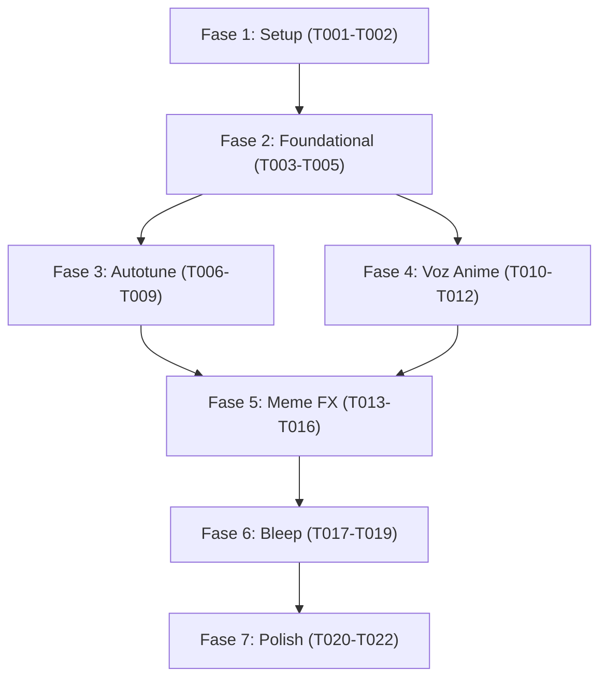

# Tasks: Streamer Fun FX & Voice Changer

**Input**: Design documents from `/specs/002-streamer-fun-fx/`  
**Prerequisites**: `plan.md`, `spec.md`, `research.md`, `data-model.md`, `contracts/fx-control-protocol.md`, `quickstart.md`, `.specify/memory/constitution.md`  
**Tests**: TDD approach strictly enforced as mandated by Constitution Principle III. Tests must be written and pass verification for all DSP algorithms and crossfades.  

---

## Phase 1: Setup (Shared Infrastructure)

**Purpose**: Inicialización del módulo DSP y herramientas de prueba de efectos.

- [X] T001 Crear estructura del módulo DSP en `desktop/src/dsp/mod.rs` y exportar en `desktop/src/lib.rs`.
- [X] T002 [P] Implementar el arnés de referencia matemática y simulación espectral de efectos en `tests/harness/fx_engine.py`.

---

## Phase 2: Foundational (Blocking Prerequisites)

**Purpose**: Estructuras de comandos de control, tipos de efectos y mezclador de crossfade sin clics.

**⚠️ CRITICAL**: El trabajo en los efectos individuales no puede comenzar hasta completar esta fase.

- [X] T003 Implementar `VoiceEffectType`, `MusicalScale`, `FxControlPacket` (8 bytes) y métodos de serialización en `desktop/src/dsp/mod.rs`.
- [X] T004 [P] Implementar el enrutador maestro `FxEngine` con fundido cruzado lineal (*crossfade*) de 2 ms (96 muestras) en `desktop/src/dsp/fx_engine.rs`.
- [X] T005 [P] Escribir pruebas unitarias del mezclador de crossfade comprobando continuidad de señal y cero clics en `desktop/tests/unit/crossfade_tests.rs`.

**Checkpoint**: Infraestructura base de efectos lista. La implementación de los algoritmos vocales puede comenzar.

---

## Phase 3: User Story 1 - Autotune melódico y robótico en tiempo real (Priority: P1) 🎯 MVP FX

**Goal**: Permitir la corrección tonal instantánea cuantizada a escalas musicales (Cromática, Mayor, Menor, Pentatónica) con velocidad de afinación percusiva ($0$ ms attack).

**Independent Test**: Inyectar un barrido senoidal de 200 Hz a 500 Hz; la salida debe saltar escalonadamente entre notas discretas afinadas de la escala sin portamento suave.

### Tests for User Story 1 ⚠️

- [X] T006 [P] [US1] Escribir pruebas unitarias del cuantizador de frecuencias a escalas musicales en `desktop/tests/unit/autotune_tests.rs`.

### Implementation for User Story 1

- [X] T007 [P] [US1] Implementar el detector de tono fundamental ($f_0$) basado en YIN simplificado en `desktop/src/dsp/autotune.rs`.
- [X] T008 [US1] Implementar el resintetizador de afinación instantánea en `desktop/src/dsp/autotune.rs`.
- [X] T009 [US1] Ejecutar validación del Escenario 1 de `quickstart.md` comprobando afinación a escala Pentatónica de La.

**Checkpoint**: Autotune 100% operativo y testeable de forma independiente.

---

## Phase 4: User Story 2 - Modulación de voz Anime / "Monita China" (Priority: P1)

**Goal**: Transformar la voz en un timbre juvenil femenino de anime mediante desacoplamiento de tono fundamental ($+5$ semitonos) y escalado de formantes ($1.20\times$) sin el efecto ardilla/helio.

**Independent Test**: Procesar una muestra de voz masculina grave (130 Hz); el resultado debe ser un timbre agudo y femenino con articulación inteligible y sin estridencias.

### Tests for User Story 2 ⚠️

- [X] T010 [P] [US2] Escribir pruebas unitarias de separación de formantes y preservación espectral en `desktop/tests/unit/anime_fx_tests.rs`.

### Implementation for User Story 2

- [X] T011 [P] [US2] Implementar el motor vocal Anime (Pitch Shift $+5$ st + Formant Scaling $1.20\times$) en `desktop/src/dsp/formant_shifter.rs`.
- [X] T012 [US2] Ejecutar validación del Escenario 2 de `quickstart.md` verificando inteligibilidad $\ge 95\%$ y ausencia de timbre de helio.

**Checkpoint**: Efecto Anime funcional y libre de artefactos.

---

## Phase 5: User Story 3 - Efectos Meme y Atmosféricos (Priority: P2)

**Goal**: Proveer presets para Radio Militar (paso banda con distorsión y Roger Beep), Demonio, Robot y Catedral Reverb.

**Independent Test**: Conmutar a Radio y verificar el filtrado telefónico y el Roger Beep al silenciar; conmutar a Catedral y verificar la cola de reverberación espaciosa.

### Implementation for User Story 3

- [X] T013 [P] [US3] Implementar el preset Radio Militar (filtro biquad 350 Hz–2.800 Hz, saturación $\tanh$ y generador de Roger Beep) en `desktop/src/dsp/meme_fx.rs`.
- [X] T014 [P] [US3] Implementar los presets Demonio ($-8$ semitonos con sub-octava) y Robot (modulación en anillo a 75 Hz) en `desktop/src/dsp/meme_fx.rs`.
- [X] T015 [P] [US3] Implementar la reverberación de Catedral basada en algoritmo Freeverb en `desktop/src/dsp/meme_fx.rs`.
- [X] T016 [US3] Ejecutar validación del Escenario 3 de `quickstart.md` comprobando la conmutación entre presets meme.

**Checkpoint**: Todos los efectos meme y espaciales operativos.

---

## Phase 6: User Story 4 - Botón de censura rápida (Push-to-Bleep) (Priority: P3)

**Goal**: Permitir tapar la voz al instante con un tono senoidal a 1.000 Hz mientras se mantenga presionado un botón táctil.

**Independent Test**: Enviar comando `Bleep` activo y comprobar que la voz es sustituida 100% por un pitido de 1.000 Hz sin clicks ni transitorios.

### Implementation for User Story 4

- [X] T017 [P] [US4] Implementar el oscilador de censura a 1.000 Hz con rampa lineal de 2 ms en `desktop/src/dsp/censor_beep.rs`.
- [X] T018 [US4] Implementar la sonda de control remoto por UDP en `tests/harness/fx_probe.py`.
- [X] T019 [US4] Ejecutar validación del Escenario 4 de `quickstart.md` verificando censura instantánea sin chasquidos.

**Checkpoint**: Bleep de censura validado.

---

## Phase 7: Polish & Cross-Cutting Concerns

**Purpose**: Integración en el daemon de PC y auditoría constitucional de rendimiento.

- [X] T020 [P] Integrar el `FxEngine` en el bucle principal de recepción y salida de audio en `desktop/src/main.rs`.
- [X] T021 [P] Ejecutar auditoría de cumplimiento de la Constitución: verificar cero `malloc` en el hilo de audio de efectos.
- [X] T022 Medir y documentar latencia adicional ($\le 5$ ms) y consumo de CPU ($\le 1.2\%$) en `specs/002-streamer-fun-fx/quickstart.md`.

---

## Dependencies & Execution Order

