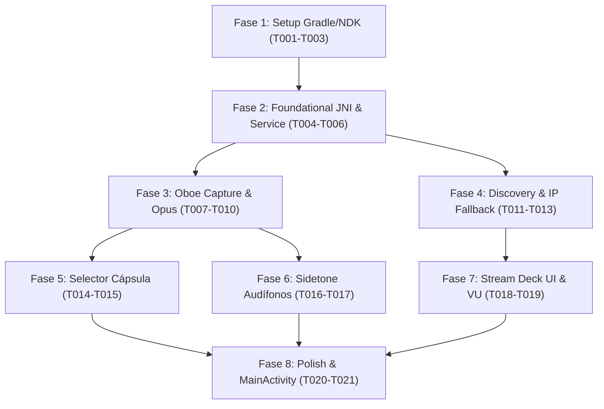

# Tasks: Android Audio Capture & Mobile Client

**Input**: Design documents from `/specs/003-android-audio-capture/`  
**Prerequisites**: `plan.md`, `spec.md`, `research.md`, `data-model.md`, `contracts/mobile-native-bridge.md`, `quickstart.md`, `.specify/memory/constitution.md`  
**Tests**: Unit tests for C++ audio framer and integration verification in Android environment.  

---

## Phase 1: Setup (Shared Infrastructure)

**Purpose**: Inicialización del proyecto de Android Studio, Gradle y dependencias nativas NDK.

- [X] T001 Crear estructura del proyecto `mobile-android/` y configurar `mobile-android/app/build.gradle.kts` con Jetpack Compose y dependencias Oboe.
- [X] T002 [P] Configurar el script de compilación nativa en `mobile-android/app/src/main/cpp/CMakeLists.txt` enlazando Google Oboe y `libopus`.
- [X] T003 [P] Declarar permisos (`RECORD_AUDIO`, `FOREGROUND_SERVICE`, `FOREGROUND_SERVICE_MICROPHONE`, `INTERNET`) en `mobile-android/app/src/main/AndroidManifest.xml`.

---

## Phase 2: Foundational (Blocking Prerequisites)

**Purpose**: Enlace JNI, cliente UDP y servicio en primer plano para persistencia con pantalla apagada.

**⚠️ CRITICAL**: El trabajo en las historias de usuario no puede comenzar hasta completar esta fase.

- [X] T004 Implementar el puente JNI nativo en `mobile-android/app/src/main/cpp/jni_bridge.cpp` y la interfaz Kotlin en `mobile-android/app/src/main/java/io/pocketmic/core/AudioEngineBridge.kt`.
- [X] T005 [P] Implementar el empaquetador de datagramas UDP con cabecera binaria `0x504D` de 16 bytes en `mobile-android/app/src/main/cpp/udp_client.cpp`.
- [X] T006 [P] Implementar `PocketMicService.kt` como `ForegroundService` con notificación persistente de captura de micrófono en `mobile-android/app/src/main/java/io/pocketmic/core/PocketMicService.kt`.

**Checkpoint**: Base nativa y servicio en segundo plano listos.

---

## Phase 3: User Story 1 - Captura acústica de alta fidelidad y baja latencia (Priority: P1) 🎯 MVP Móvil

**Goal**: Capturar la voz a 48 kHz / 32-bit Float con Google Oboe (AAudio), codificar en frames Opus de 10 ms y transmitir vía UDP a la PC con latencia $< 6$ ms.

**Independent Test**: Iniciar la app, hablar al teléfono y comprobar que la voz se recibe en tiempo real en el daemon de PC (`receiver_daemon.py`).

### Implementation for User Story 1

- [X] T007 [P] [US1] Implementar el motor de captura de audio Oboe C++ (`AudioEngine`) configurado con `AAudio` y modo `PerformanceMode::LowLatency` en `mobile-android/app/src/main/cpp/audio_engine.cpp`.
- [X] T008 [P] [US1] Implementar el codificador Opus nativo C++ (`OpusEncoderWrapper`) configurado en modo VOIP a 48 kHz en `mobile-android/app/src/main/cpp/opus_encoder.cpp`.
- [X] T009 [US1] Conectar el callback de captura de Oboe (`onAudioReady`) al codificador Opus y al cliente UDP en `mobile-android/app/src/main/cpp/audio_engine.cpp`.
- [X] T010 [US1] Validar transmisión en vivo desde el smartphone al daemon de PC verificando recepción limpia a 48 kHz de acuerdo con `quickstart.md`.

**Checkpoint**: User Story 1 (Captura nativa Oboe + Opus) 100% operativa.

---

## Phase 4: User Story 2 - Emparejamiento y transmisión por red con fallback manual (Priority: P1)

**Goal**: Auto-detectar la PC mediante UDP broadcast en puerto 37718 y permitir ingresar la IP de la computadora manualmente si hay *AP Isolation*.

**Independent Test**: Abrir la app en red normal (auto-descubrimiento en $< 2$ s) y probar el diálogo de conexión manual por IP.

### Implementation for User Story 2

- [X] T011 [P] [US2] Implementar el cliente de descubrimiento broadcast en `mobile-android/app/src/main/java/io/pocketmic/net/DiscoveryClient.kt`.
- [X] T012 [US2] Implementar el diálogo de ingreso manual de dirección IP y selección de host en `mobile-android/app/src/main/java/io/pocketmic/ui/ConnectDialog.kt`.
- [X] T013 [US2] Validar emparejamiento automático por broadcast y conexión directa manual.

**Checkpoint**: Conectividad flexible y resiliente operativa.

---

## Phase 5: User Story 3 - Selector de cápsula física de micrófono (Priority: P2)

**Goal**: Permitir alternar entre micrófono inferior (mano alzada) y superior/frontal (atril/mesa) para evitar sonido tapado.

**Independent Test**: Cambiar a "Micrófono Superior" con el teléfono apoyado y verificar que la captación sonora se mantiene nítida y brillante.

### Implementation for User Story 3

- [X] T014 [P] [US3] Implementar selección de cápsula mediante `MicrophoneDirection` y `setPreferredDevice` en `mobile-android/app/src/main/cpp/audio_engine.cpp`.
- [X] T015 [US3] Crear el componente visual de selector de cápsula en `mobile-android/app/src/main/java/io/pocketmic/ui/components/CapsuleSelector.kt`.

**Checkpoint**: Selector de cápsula acústica verificado.

---

## Phase 6: User Story 4 - Sidetone local en audífonos (Priority: P2)

**Goal**: Proveer retorno de la propia voz en auriculares con latencia inmediata ($< 2$ ms).

**Independent Test**: Conectar audífonos, hablar y escuchar el retorno instantáneo; desconectar y verificar silenciado de seguridad.

### Implementation for User Story 4

- [X] T016 [P] [US4] Implementar el flujo de sidetone en el callback de Oboe desviando audio a la salida de auriculares en `mobile-android/app/src/main/cpp/audio_engine.cpp`.
- [X] T017 [US4] Implementar receptor de eventos de desconexión de audífonos para silenciar sidetone en `mobile-android/app/src/main/java/io/pocketmic/core/HeadphoneReceiver.kt`.

**Checkpoint**: Sidetone local de latencia cero verificado.

---

## Phase 7: User Story 5 - Panel táctil tipo Stream Deck y VU Meter (Priority: P3)

**Goal**: Ofrecer medidor VU en vivo con alerta de clipping y cuadrícula de botones para activar efectos (Autotune, Anime, Radio, Bleep) en la PC.

**Independent Test**: Tocar los botones del móvil y comprobar que el daemon de PC recibe el comando de efecto en $< 5$ ms.

### Implementation for User Story 5

- [X] T018 [P] [US5] Implementar componente de medidor VU reactivo con colores verde/amarillo/rojo en `mobile-android/app/src/main/java/io/pocketmic/ui/components/VuMeter.kt`.
- [X] T019 [US5] Implementar la cuadrícula táctil `StreamDeckGrid.kt` con soporte para Autotune, Anime, Memes y botón `Push-to-Bleep` en `mobile-android/app/src/main/java/io/pocketmic/ui/components/StreamDeckGrid.kt`.

**Checkpoint**: Panel de control interactivo completado.

---

## Phase 8: Polish & Cross-Cutting Concerns

**Purpose**: Integración en UI principal y mediciones de consumo de batería y latencia.

- [X] T020 [P] Integrar todos los componentes en la pantalla principal `MainActivity.kt` en `mobile-android/app/src/main/java/io/pocketmic/ui/MainActivity.kt`.
- [X] T021 Medir y documentar latencia de captura interna ($\le 6$ ms) y consumo de batería ($\le 5\%$/h) en `specs/003-android-audio-capture/quickstart.md`.

---

## Dependencies & Execution Order

